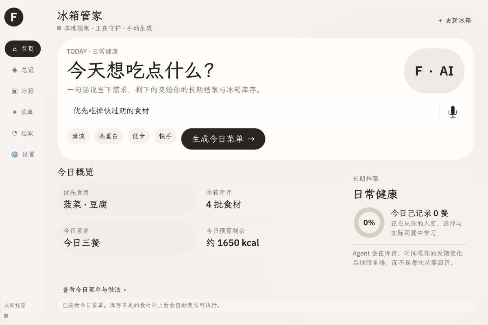

# 冰箱管家 · Pantry Steward

简体中文 | [English](README.md)

把确认过的库存，变成可以复核并执行的一顿饭。

## 版本与验证范围

此功能分支是尚未发布的 Issue #2 **0.8.0 源码候选**，并包含 Issue #8–#11 与 #23–#28 的功能（六周期候选、组合计划、未来阶段编辑、总览页、三餐日菜单与派生缺菜清单、模拟买菜区域与其待核对购物车、确认收货）。除手动库存、周期和菜单外，它在具备图片能力的本地改版宿主上提供拍照／导入图片识别草稿；官方宿主回退手动录入。源码包通过当前固定版本 App Hub 门禁。[Issue #99](https://github.com/OctoSense-org/OctoSense-App-Hub/issues/99) 请求审核的是 **0.6.1**，不是此候选；不声称已发布或获 App Hub 审批。

目标平台仅为 Windows。2026-10-11，0.8.0 包通过固定版本 App Hub 检查，19 项 Python 测试通过；未修改的官方完整宿主在隔离档案完成 26 项 UI／数据检查和重启检查，两种图片入口都显示手动回退。本地改版宿主通过图片能力探测、共用选择界面及取消不写库检查；任务专用模拟结果验证了两类可编辑草稿和多行一次入库。用户报告剩余的 MiniMax 图片、摄像头、重试和重启前台验收通过；没有逐步独立日志。正式 Store 发布仍未验证。见[验证记录](VALIDATION.md)。

## 功能闭环

确认饮食档案及 1／3／7／15／21／30 天周期（每周期 3 份候选，可单独重新生成；1 天用于短周期体验）；可直接确认单选，也可按顺序组合不同周期（允许重复，如 7+7），确认前可调整顺序、移除或用其它候选替换，组合页显示总天数与各阶段起止日期和目标，单个计划最多 12 个阶段。已确认阶段在起止日期开始时锁定；尚未开始的阶段仍可在「档案」页调整顺序、替换、移除或改目标，重算其后阶段的日期与计划总天数，已确认的进度与用餐记录不受影响。然后预览库存批次 → 生成本地规则或官方 model.complete 的三餐日菜单（一次调用，早／中／晚）→ 查看每餐食材、克数与营养参考 → 接受菜单（库存不足仍可接受）→ 查看缺菜清单（三餐重复食材合并成一个缺口 = 日菜单用量 − 库存可用；在清单上改数量改的是日菜单用量，清单不存储，库存一变立刻重算）→ 单独确认实际食用量，才扣库存和累计摄入。每个已确认阶段都是所属方案的快照，之后改候选不影响它。总览页展示长期计划、当前阶段、当天每餐进度，以及当前阶段热量、蛋白质目标与实际值的对比；进度只按已完成餐次 ÷（周期天数 × 3）累计，仅生成或确认菜单不改变进度，只有确认实际食用才增加；目标随日期覆盖今天的阶段自动切换。

此工作分支把过敏、忌口和饮食偏好分开；录入先生成可编辑草稿，再由用户确认入库。支持 g/kg、ml/L、个，以及由用户确认换算量的简单包装单位。同名食材按组展示，每批仍可分别编辑或移除。图片识别仅在本地改版宿主报告 `model.vision_capability` 时启用；结果中不确定的字段由用户补齐。

缺菜清单上的「一键补齐」在同一窗口打开应用内的模拟买菜区域（不是第二个打包单元，不改应用 id，也不新增授权）：它带入当前派生的缺菜清单，逐行标注 已对应模拟商品 或 无对应模拟商品，并提供固定的 24 条模拟商品目录与列表、详情两页（名称、品类、规格、单位、价格、可售数量、每 100 g 营养参考、参考保质期）。商品／购物车／订单是区域自己的导航，返回管家 回到管家且不改变其页签。每页都标注 模拟平台／模拟下单；目录随包提供，应用未声明任何购物网络能力，因此不会产生真实购买或支付，也不改变冰箱库存。进入区域时会按名称、规格与数量填好一份待核对购物车（采购数量按规格向上取整）；目录里挑不到或可售数量不足的行会标注 无匹配／可售不足 并给出 替换 入口，而不是被静默丢弃；替换会优先同品类、按规格接近度排序，并排除过敏与忌口。购物车是用户输入：增减数量、删除与替换在重启后仍在，并显示模拟单价与总价。购物车只有经用户确认后才提交为模拟订单，之后订单页显示订单及其 待收货 状态、各行明细与模拟总价，并说明提交不产生真实购买或支付。提交只写入订单：库存、进度与实际执行记录都不变，订单在重启后保留。无匹配的行没有商品可下单，会留在购物车里；可售不足的行按下单时的可售上限下单。待收货 订单上的「确认收货」逐行核对：收货数量默认等于下单数量且只能改小，保质期默认取模拟商品的保质期天数（今天加天数）并可修改。只有核对过的数量才会作为新批次入库（每条新批次都有新编号和自己的到货日期，不合并进已有批次），库存页立刻可见；没核对的部分仍由缺菜清单重算出来。确认收货不写实际执行记录，也不增加进度。

今日和阶段数值为原型估算。存档旧计划保留库存与计划历史。默认手动生成；可在设置中主动开启自动生成，但接受菜单和扣减仍须确认。删除菜谱不回滚库存或删除摄入记录。详见[周期说明](CYCLE-PLANS.md)。

## 演示

[历史手动流程录屏](video/演示视频.mp4)



[三餐日菜单与缺菜清单](bundle/screenshots/02-plan.png) · [缺菜清单与可编辑缺口](bundle/screenshots/03-confirm.png) · [库存](bundle/screenshots/04-updated.png)

四张截图为当前 0.8.0 在隐藏 Windows card-host 中的合成数据截图（1200x800）：首页；三餐日菜单（早／中／晚）与派生缺菜清单；缺菜清单显示 还差 941 克 及可编辑数量；库存批次。录屏仍为先前 0.7.0 手动流程。当前版其它合成数据截图包括[首页](docs/qa/issue-2-home-after.png)、[修改用户画像](docs/qa/issue-2-profile-edit-after.png)、[库存](docs/qa/issue-2-inventory-after.png)、[改版宿主图片选择](docs/qa/issue-2-image-chooser-after.png)、[官方宿主手动提示](docs/qa/issue-2-official-fallback-after.png)、[菜谱](docs/qa/issue-2-recipe-after.png)和[食用前核对](docs/qa/issue-2-consumption-after.png)、[模拟买菜区域](docs/qa/issue-25-market.png)、其[带 无匹配／可售不足 标注与模拟总价的待核对购物车](docs/qa/issue-26-cart.png)，以及[同品类替换列表](docs/qa/issue-26-replace.png)，和[提交后显示 待收货 的模拟订单](docs/qa/issue-27-order.png)，以及[确认收货的核对数量与保质期界面](docs/qa/issue-28-receive.png)。截图只说明界面，不能证明真实图片识别、Store 发布或真实模型响应。新录屏不属于本次 PR。

## Windows 源码运行

本仓库只含应用，不是完整宿主或安装包。入口是根目录 run.cmd，不是 apps/pantry-steward/run.cmd。

需要 Git、Python 3.11+、Rust、Windows C++ 工具和 Windows SDK。按[官方 Quickstart](https://github.com/OctoSense-org/OctoScript-App-Design-Flow/blob/main/docs/QUICKSTART.md)准备当前原生工作区。0.8.0 的摄像头授权声明要求完整 OctoSense shell；独立 card-host 不实现该授权代理。

早期 0.6.2 发布工作流固定 App Hub 655114c4943cd2490daaefa2173e7b5aaa20669f；当前 OctoSense 宿主固定的是 App Hub 8347a489141c0e24cab564883db7c4592935a8b2。验证此编辑后的 bundle 须使用当前宿主固定版本。

固定版本工具在同级 OctoSense 仓库中构建后，从本应用目录用全新测试档案执行。第二条命令使用该仓库的当前分支；它是未修改官方宿主还是本地改版宿主，取决于检出版本。第二条命令保持运行，第三条在另一个终端执行：

```cmd
run.cmd --hub ..\OctoSense\target\release\hub.exe --check
run.cmd --host-workspace ..\OctoSense --hidden --remote 18442 --app-data target\qa-d2
python -X utf8 tools\smoke.py --port 18442 --profile target\qa-d2
```

`--hub --check` 不需要宿主工程或密钥。完整宿主的隔离安装需要此前经本人许可生成的本地测试密钥；原生冒烟脚本需要全新、隔离的 `--app-data` 目录。重启相同档案后可加 `--restart` 核对持久化。

启动器只校验现有摘要，不自动修复。当前 0.8.0 候选已用固定版本 App Hub 重新盖章并通过包检查；修改 bundle 后须再次盖章。

本机 D2 已用本地测试签名在完整宿主的隔离档案中安装；这不是正式 Store 发布。`--prepare-local-test` 会在 Git 之外创建本地测试密钥，必须取得本人同意。测试不能使用他人的现有库存。

图片 AI 必须在本地改版 OctoSense 宿主中测试，并在宿主 AI providers 页配置提供方。未修改的官方完整宿主已单独通过手动回退检查；不能仅凭上面的命令认定宿主为官方版本。用户报告 MiniMax 图片识别前台验收通过。正式封存包还要求 publisher-github-v1 支持；本地测试签名安装不等于正式发布。

## AI、隐私和边界

- storage 保存应用自己的库存、档案、方案、历史、备份和用户选择的图片。
- model 经官方宿主将目标、填写的档案（包括过敏、忌口和偏好）、合格批次的名称与原生单位／数量发送到用户配置的模型提供方。数值规划另发送估算克数、营养参考和周期余额；未核算菜谱仅标注营养参考是否完整。密钥留在宿主；应用不读取 ai.env 或收集密钥。
- 在宿主的 AI providers 页面配置模型。预算查询成功不代表模型已配置。失败时手动选择本地规则。停止等待不保证撤销已发送或计费的请求。
- 图片识别需相机／文件权限。Windows 本地改版宿主只接受一张应用内 JPEG、PNG 或 WebP 图片，最大 10 MiB；仅支持 `minimax`／`minimax-cn` 的 `MiniMax-M3` 或 `moonshot` 的 `kimi-k2.5`，将图片及识别提示词送至用户配置的提供方，返回可编辑草稿。官方宿主不支持时显示手动录入提示。没有直接联网主机、麦克风权限或独立应用 Agent 工具；语音不可用，宿主关闭后不后台执行。
- 营养数值为原型估算，不是医疗建议，不保证过敏或食品安全。生成时优先使用具备完整营养参考的食材；一份日菜单只有在过敏忌口、营养参考完整且不超出当天剩余额度时才能被接受；库存不足只影响每样食材的状态，不阻止接受，补上后菜单自动可执行。缺菜清单由「日菜单用量 − 库存可用」实时算出（只算未过期且未被忌口排除的批次），不写入存储；在清单上改数量改的是日菜单用量，重启后由日菜单与库存重算出同样结果。

用户报告本候选的在线菜谱和图片识别前台检查通过；未留存完整的独立提供方逐步日志。参见发布者已确认的[隐私说明](PRIVACY.md)、[支持说明](SUPPORT.md)和[审核回答](REVIEW-ANSWERS.md)。

## 发布

只分发 bundle/；工具、视频、审核包和本地状态留在包外。Git 属性保护 Windows 下的原始包字节。

[App Hub 提交指南](https://github.com/OctoSense-org/OctoSense-App-Hub/blob/main/docs/SUBMITTING.md)说明发布路线。0.8.0 候选尚需正式发布证据复核、公开链接核对及另行取得本人发布授权。不声称已运行发布工作流、推标签、发布、创建新 Issue 或获批。

待本人确认的环节见[提交准备](SUBMISSION.md)。源码检查或工作流成功不等于比赛合格或 Hub 审核通过。

## 许可证与来源

[Apache License 2.0](LICENSE)，参见 [NOTICE](NOTICE)。依赖和第三方素材保留各自许可证。作者于 2026-10-08 确认 sunlit-pantry-bg.png 为本人原创，已在 NOTICE 记录；这是作者声明，不是独立权属鉴定或 Hub 审批。

作者：leoniaodo、zix、power胖丸、Roooy。

[OctoSense](https://github.com/OctoSense-org/OctoSense) · [Design Flow](https://github.com/OctoSense-org/OctoScript-App-Design-Flow) · [App Hub](https://github.com/OctoSense-org/OctoSense-App-Hub)
