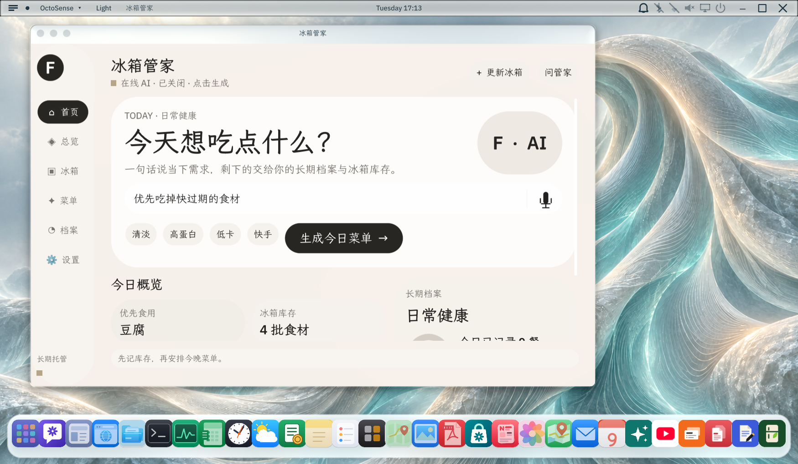

# 冰箱管家 · Pantry Steward

[English](README.md) | 简体中文

从确认过的冰箱库存出发，规划三餐；只有确认实际食用才更新库存与摄入。

## 版本与发布状态

当前为 **0.8.0 发布候选**，应用仓库独立于配套 OctoSense 宿主。保留 App ID `pantry-steward`。本仓库由原应用仓库改名而来；版本标签和历史记录不移动或覆盖。

本次发布准备以源码提交 `c814a7d0d8659cebfabcd2dcb4711e6f27b5308d` 为基线，不改业务脚本。GitHub Release、封存包验证和 App Hub 审核仍待完成；本地检查通过不代表上架。原申请为 [App Hub #166](https://github.com/OctoSense-org/OctoSense-App-Hub/issues/166)。

## 功能

- 个人建档：区分健康方向、过敏、忌口和普通饮食偏好。
- 库存：确认草稿才入库，同名食材按批保存，支持数量、原生单位、换算量及到期信息。
- 方案：1／3／7／15／21／30 天候选；可组合最多 12 个阶段，确认前调整顺序、移除或替换。已开始阶段锁定，修改未来阶段不覆盖实际记录。
- 日菜单：通过宿主在线 AI 生成早、中、晚三餐。生成时只用合格库存，不凭空加入库存外食材；生成和接受都不扣库存。
- 缺菜与模拟买菜：库存随后变化产生的差额实时计算。模拟商品、购物车、订单和确认收货在应用内运行，不接美团、不支付、不配送；仅确认收货才新增库存批次。
- 实际执行：核对每餐实际食物和数量，最终确认后追加独立快照、扣库存并更新摄入与进度；推荐与实际分开。
- 1 天体验：仅用库存、不补菜，三餐实际确认后完成并复盘。
- 问管家：同日多轮文字对话和软记忆通过宿主 `model.complete` 实现；建议先交给现有核对页，最终确认才修改业务。不是独立后台 octos 应用 Agent。
- 可选图片／语音：按实际宿主和提供方能力启用。图片返回可编辑入库草稿；语音转写只填入输入框，另点发送才对话。能力缺失时保留手动／文字路径。

六周期与阶段规则见 [CYCLE-PLANS.md](CYCLE-PLANS.md)，体验与执行规则见 [EXPERIENCE.md](EXPERIENCE.md)，领域决策见 [GLOSSARY.md](GLOSSARY.md) 和 docs/adr/。

## 宿主与模型边界

配套改版 Windows 宿主：[woshuoduijiushidui/OctoSense](https://github.com/woshuoduijiushidui/OctoSense)。应用包不携带该宿主或其原生代码，也不为商店增加宿主接口。

图片识别使用宿主报告的 `model.complete@2`；语音依赖前台麦克风与转写接口及兼容提供方。不能因为某个官方版本更新或 capability 声明通过，就保证录音／图片可用。未修改的官方发布版在本次发布准备中未重新验收。

菜单、营养估算和对话需要在线 AI。关闭或不可用时给出提示，不生成伪造的本地替代菜单；库存和既有记录仍可管理。提供方与密钥在宿主自己的 AI providers 界面设置；应用不读取 ai.env、不收集密钥。

营养可能来自用户、包装数据或带来源／假设的 AI 估算，仅供规划参考，不是医疗建议，不保证营养、过敏或食品安全。详情见 [PRIVACY.md](PRIVACY.md)。

## 本次检查与截图

2026-10-14 发布准备：

- 当前官方 App Hub `386359153ed6377b5f047bd9ed2767a6a2ac2bc7` 检查源包通过，仅有预期的 unsigned 警告。
- 36 项自动测试全部通过，包括固定 Makepad Script VM 对生产业务 helper 的检查。
- 使用已有本地测试签名样本、相同业务脚本与空的测试提供方／账号档案，在配套改版 Windows 宿主完成 19 项原生检查及 2 项重启检查。
- 已检查新的四张真实运行截图；全部使用合成库存、关闭在线 AI，没有触发真实录音或模型请求。



[库存](bundle/screenshots/06-current-inventory.png) · [未发送的问管家草稿](bundle/screenshots/07-current-chat-draft.png) · [设置](bundle/screenshots/08-current-settings.png)

以上截图不是实时 AI 结果或实机相机／录音成功的证明。旧 01–04 截图保留作历史资料，不列为本次商店截图；[历史录屏](video/演示视频.mp4)也不是新版本全流程证据。既有历史测试见 [VALIDATION.md](VALIDATION.md)，本次检查见 [review/LOCAL-CHECKS.md](review/LOCAL-CHECKS.md)。

**未验证**：本次真实在线模型、ASR、真实相机／图片请求；最终 GitHub-attested 发布包；官方发布版中的安装／升级及完整新功能回归；Android、iOS、macOS、Linux。

## 开发检查

需要 Git、Python 3.11+ 和 Rust；Windows 原生构建还需 C++ 构建工具和 SDK。

将当前官方工具加入 PATH 后，检查命令（本次使用绝对工具路径执行了等价命令）：

```text
hub check bundle --allow-unsigned
hub scan bundle --packet build/review.json
python -B -X utf8 -m unittest discover -s tools -p "test_*.py"
```

完整 VM 测试另需 `OCTOSENSE_HOST_WORKSPACE` 指向已经准备好的宿主源码；未配置时该项会明确跳过。不要把跳过当作通过。

`card-host` 不提供模型、相机或录音服务，并且当前版拒绝要求 `host-api-v1` 的应用。不要删掉 manifest 的 requires 来让预览通过。完整运行应使用兼容宿主和独立测试档案，不能使用个人真实库存进行 QA。

修改源包后重新 `hub stamp bundle`，再检查；不要重盖章封存包。启动器的旧测试签名路径只用于经本人许可的本地演练，不是正式发布身份。

## 发布

只提交 bundle/；模型配置、库存、密钥、测试档案和审核包留在包外。工作流和 publisher-toolchain.json 固定当前官方工具提交，使用 [官方 GitHub 发布流程](https://github.com/OctoSense-org/OctoSense-App-Hub/blob/main/docs/SUBMITTING.md)。

源码提交、版本标签和公开 Release 需要发布者确认。工作流成功后下载并验证最终包与发布回执，再补充原审核申请；本次尚未执行这些外部步骤。操作清单见 [SUBMISSION.md](SUBMISSION.md)，申请草稿见 [review/APP-HUB-ISSUE.md](review/APP-HUB-ISSUE.md)。

## 许可证与支持

[Apache License 2.0](LICENSE)；[NOTICE](NOTICE) 记录来源声明。作者于 2026-10-08 确认背景图为本人原创，此为作者声明，不是独立权属鉴定。

作者：leoniaodo、zix、power胖丸、Roooy。支持：[仓库 Issues](https://github.com/woshuoduijiushidui/pantry-steward/issues)。反馈勿附密钥、个人档案或完整真实库存。
